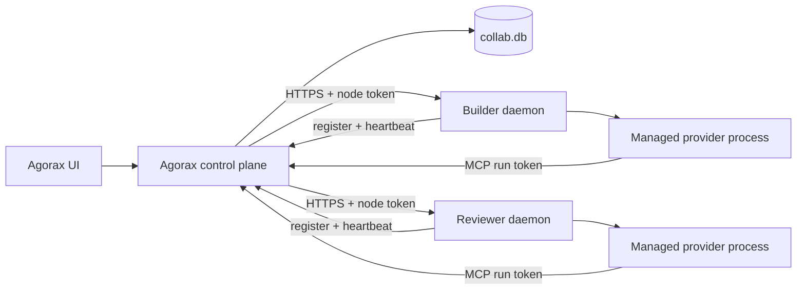

# Managed Multi-Machine Execution

Agorax can run managed agents on independently operated machines while keeping Mission and assignment state in one control plane. A managed agent is fixed to an execution node with `agents.yaml.nodeId`; the selected node runs the provider process and streams activity back to Agorax.

This feature applies to managed runtimes such as Claude Code, Codex, Cursor, OpenCode, and Kimi. Hermes remote execution continues to use profile gateways and the existing SSH contract.

## Architecture



The control plane owns:

- Mission and assignment progression
- execution-node directory and health
- assignment claim, lease, and attempt fencing
- run tokens, MCP writes, review gates, and human gates

Each execution node owns:

- local provider discovery and process launch
- provider Session and Turn lifecycle
- local credentials and provider configuration
- activity delivery over its authenticated WebSocket

One assignment attempt runs on one node. A Mission may contain several assignments bound to different nodes, so collaboration occurs through assignment dependencies, checkpoints, commits, and review stages rather than by sharing one provider process.

## Requirements

Control plane:

- Agorax with a shared `collab.db`
- HTTPS endpoint reachable by every remote node
- SSH access to each code-execution node when using `workspaceMode: worktree`
- an externally reachable HTTPS `HERMES_MCP_ENDPOINT` for remote task completion

Execution node:

- the `agorax-agentd` binary built from the same compatible Agorax version
- one or more supported provider CLIs installed and authenticated locally
- an HTTPS reverse proxy or encrypted tunnel in front of the daemon when it is not loopback-only
- a persistent directory for `AGORAX_AGENT_DB_PATH`

Never expose a plain HTTP daemon on a routable interface. Agorax accepts plain HTTP node URLs only for loopback development.

## Token Model

Multi-machine operation uses two different secrets.

| Secret                | Control-plane variable                             | Node variable                 | Purpose                                                          |
| --------------------- | -------------------------------------------------- | ----------------------------- | ---------------------------------------------------------------- |
| Registration token    | `AGORAX_EXECUTION_NODE_REGISTRATION_TOKEN`         | `AGORAX_EXECUTION_NODE_TOKEN` | Authorizes node registration and heartbeat                       |
| Per-node daemon token | `AGORAX_EXECUTION_NODE_TOKEN_<NORMALIZED_NODE_ID>` | `AGORAX_MANAGED_AGENT_TOKEN`  | Authorizes control-plane HTTP and WebSocket calls to that daemon |

For node id `builder-1`, the normalized control-plane variable is:

```bash
AGORAX_EXECUTION_NODE_TOKEN_BUILDER_1=replace-with-a-strong-secret
```

Normalization uppercases the node id and replaces non-alphanumeric characters with `_`. Secrets are environment-only: do not put them in `agents.yaml`, `projects.yaml`, or `collab.db`.

When `AGORAX_EXECUTION_NODE_REGISTRATION_TOKEN` is configured, `POST` and `PATCH /api/execution-nodes` require that bearer token even for loopback requests. This prevents local-request authentication from bypassing node identity.

## Configure the Control Plane

Add the following to the control-plane environment:

```bash
AGORAX_EXECUTION_NODE_REGISTRATION_TOKEN=replace-with-registration-secret
AGORAX_EXECUTION_NODE_STALE_MS=45000
AGORAX_EXECUTION_NODE_TOKEN_BUILDER_1=replace-with-builder-secret
AGORAX_EXECUTION_NODE_TOKEN_REVIEWER_1=replace-with-reviewer-secret

# Remote agents call this endpoint to report task state.
HERMES_MCP_ENDPOINT=https://agorax.example.com/api/mcp-rpc

# Keep distributed assignment fencing enabled in production.
AGORAX_DISTRIBUTED_TASK_CLAIMS=1
AGORAX_SCHEDULER_OWNER_ID=control-plane-1
```

`AGORAX_EXECUTION_NODE_STALE_MS` defaults to 45 seconds. The daemon heartbeats every 15 seconds.

Start Agorax normally:

```bash
pnpm build
pnpm start
```

## Build and Start a Node

Build the daemon from the repository:

```bash
cd agorax-agent-daemon

go build \
  -o ./bin/agorax-agentd \
  ./packages/agent/daemon/cmd/agorax-agentd
```

Configure one execution node:

```bash
export AGORAX_MANAGED_AGENT_HOST=127.0.0.1
export AGORAX_MANAGED_AGENT_PORT=8788
export AGORAX_AGENT_DB_PATH=/var/lib/agorax-agent/agent.db
export AGORAX_WORKSPACE_ID=default

export AGORAX_CONTROL_PLANE_URL=https://agorax.example.com
export AGORAX_EXECUTION_NODE_TOKEN=replace-with-registration-secret
export AGORAX_EXECUTION_NODE_ID=builder-1
export AGORAX_EXECUTION_NODE_NAME='Builder workstation'
export AGORAX_EXECUTION_NODE_URL=https://builder-1.example.com

export AGORAX_MANAGED_AGENT_TOKEN=replace-with-builder-secret

./bin/agorax-agentd
```

`AGORAX_EXECUTION_NODE_URL` is the address the control plane uses to contact this daemon. It may be the URL of a Tailscale Serve endpoint or another TLS reverse proxy. Binding the daemon to `127.0.0.1` behind that proxy is preferred over exposing its HTTP server directly.

On startup, the daemon registers itself with `POST /api/execution-nodes`. It then updates its provider capabilities and `last_seen_at` with `PATCH /api/execution-nodes` every 15 seconds.

## Bind an Agent to a Node

Add `nodeId` to a managed agent declaration in the local, gitignored `agents.yaml`:

```yaml
version: 1
agents:
  - id: remote-builder
    name: Remote Builder
    runtime: claude-code
    command: claude
    nodeId: builder-1
    capabilities:
      - code
      - test
    maxConcurrentTasks: 1
```

Rules:

- `nodeId` is supported only for managed runtimes.
- Omitting `nodeId` keeps the existing local `AGORAX_MANAGED_AGENT_URL` path.
- A missing, offline, or stale bound node makes the adapter unavailable. Agorax does not silently fall back to the local daemon.
- Node binding is fixed for each declared agent; this release does not perform automatic load balancing or failover to another node.

Restart or reload the Agorax server after editing `agents.yaml`. Registry API writes automatically reset the runtime router.

## Configure Code Worktrees

For a Mission using `workspaceMode: worktree`, map each execution node to an SSH host and node-local paths in `projects.yaml`:

```yaml
version: 1
projects:
  - id: product
    repo: /srv/repos/product
    defaultBranch: main
    worktreeRoot: /srv/agorax-worktrees/product
    gitRemote: origin
    maxConcurrentWorktrees: 4
    selfHosted: false
    setup:
      - pnpm install --frozen-lockfile
    remotes:
      builder-host:
        nodeId: builder-1
        repo: /srv/repos/product
        worktreeRoot: /srv/agorax-worktrees/product
        setup:
          - pnpm install --frozen-lockfile
      reviewer-host:
        nodeId: reviewer-1
        repo: /srv/repos/product
        worktreeRoot: /srv/agorax-worktrees/product
```

The map key (`builder-host`) is the SSH host used by the control plane. `nodeId` connects that SSH location to the managed daemon registration.

For a remote assignment, Agorax:

1. ensures the Mission branch and local integration worktree exist;
2. pushes the Mission branch to the declared SSH repository;
3. creates or reuses the node-local worktree through the existing SSH Git boundary;
4. passes only the node-local `cwd` to the selected daemon;
5. injects a run-scoped MCP token so the agent can report start, completion, or failure.

The node must already have the declared repository path. This release does not automatically clone repositories onto new nodes.

Cross-OS remote worktrees are not yet an accepted path: the control plane currently constructs remote worktree paths with its own path semantics. A Windows daemon can run managed chat, but code worktree execution between POSIX and Windows requires separate validation.

## Assignment Ownership

`collab.db.task_dispatch_claims` provides cross-process dispatch exclusion.

- The first scheduler acquires the assignment with `BEGIN IMMEDIATE`.
- A claim records `owner_id`, `node_id`, `attempt`, and `lease_expires_at`.
- Active task events renew the lease.
- A retry after expiry increments `attempt`.
- An older attempt cannot release or overwrite the newer owner.
- Terminal checkpoints mark the claim terminal and release scheduler capacity immediately.

The default lease is 10 minutes, which exceeds the default 5-minute scheduler stall window. Do not disable distributed claims in production. `AGORAX_DISTRIBUTED_TASK_CLAIMS=0` is for single-process diagnostics only.

Database migrations also use `BEGIN IMMEDIATE` and recheck the migration version while holding the writer lock. This allows several control-plane processes to open a new `collab.db` concurrently without both applying the same migration.

## API Summary

| Method   | Endpoint               | Authentication                                                                        | Behavior                                          |
| -------- | ---------------------- | ------------------------------------------------------------------------------------- | ------------------------------------------------- |
| `GET`    | `/api/execution-nodes` | Agorax session                                                                        | Lists nodes and marks stale registrations offline |
| `POST`   | `/api/execution-nodes` | Registration bearer token, or Agorax session when no registration token is configured | Registers or replaces node metadata               |
| `PATCH`  | `/api/execution-nodes` | Registration bearer token, or Agorax session when no registration token is configured | Updates heartbeat and capabilities                |
| `DELETE` | `/api/execution-nodes` | Agorax session                                                                        | Deletes an unbound node                           |

Deletion fails while any agent declaration references the node.

Example heartbeat:

```bash
curl -X PATCH https://agorax.example.com/api/execution-nodes \
  -H 'Authorization: Bearer <registration-token>' \
  -H 'Content-Type: application/json' \
  --data '{"id":"builder-1","capabilities":["claude-code","codex"]}'
```

## Health and Troubleshooting

Check daemon authentication:

```bash
curl -H 'Authorization: Bearer <node-daemon-token>' \
  https://builder-1.example.com/health
```

Expected response:

```json
{ "ok": true, "runtime": "agorax-managed-agent" }
```

Common failures:

### Node is missing or offline

- Confirm the daemon process is running.
- Confirm `AGORAX_CONTROL_PLANE_URL` is reachable from the node.
- Check that node `AGORAX_EXECUTION_NODE_TOKEN` matches control-plane `AGORAX_EXECUTION_NODE_REGISTRATION_TOKEN`.
- Check the control-plane clock and `AGORAX_EXECUTION_NODE_STALE_MS`.
- A restarted node should register again and return to `online` automatically.

### Managed target is not registered

- Call authenticated `/v1/agent-targets` on the node.
- Confirm the provider CLI is installed and enabled on that machine.
- Provider credentials belong on the execution node, not the control plane.

### Remote node cannot reach loopback MCP endpoint

Set `HERMES_MCP_ENDPOINT` on the control plane to an HTTPS URL reachable from the node. Agorax intentionally rejects remote dispatch when the MCP endpoint resolves to loopback.

### Project has no remote mapped to the node

Add a `projects.yaml.remotes` entry with the matching `nodeId`. Confirm the SSH host, repository path, and worktree root exist on the node.

### Assignment remains claimed

- Inspect the assignment state and latest task events.
- Verify task activity is renewing the lease.
- The scheduler requeues stalled work after its stall timeout; a later owner receives a higher attempt number.
- Never manually copy or delete claim rows while a control-plane process is active.

## Verification

Run the focused automated suite:

```bash
AGORAX_AUTO_START_AGENT=false pnpm exec vitest run \
  src/server/execution-nodes.test.ts \
  src/server/agent-runtime/agent-runtime.test.ts \
  src/server/agent-runtime/agorax-managed-agent-transport.test.ts \
  src/server/agent-runtime/managed-agent-daemon.test.ts \
  src/server/task-pipeline/projects.test.ts \
  src/server/task-pipeline/dispatch-claim-store.test.ts \
  src/server/task-pipeline/task-scheduler.test.ts \
  src/server/task-pipeline/dispatch-ready.test.ts \
  src/server/agent-runtime/e2e-dispatch.test.ts
```

Run the daemon tests:

```bash
cd agorax-agent-daemon
go test ./packages/agent/daemon/cmd/agorax-agentd
```

Then run:

```bash
pnpm build
git diff --check
```

For a deployment check, use two daemon processes with distinct node ids, ports, databases, and daemon tokens. Verify registration, wrong-token rejection, heartbeat updates, single-winner assignment claiming, offline convergence after the stale timeout, and automatic recovery after restart.

## Current Limitations

- Node management is API/config based; there is no dedicated node-management UI yet.
- Agent-to-node binding is static. There is no automatic load balancing or cross-node failover.
- A single assignment attempt does not execute jointly on several nodes.
- New nodes require pre-existing project repositories for worktree Missions.
- Physical two-machine TLS deployment remains an environment-level acceptance step; repository tests and local validation use separate daemon processes as the machine boundary.
- Hermes workers use their existing gateway/profile remote execution path rather than execution-node `nodeId`.
